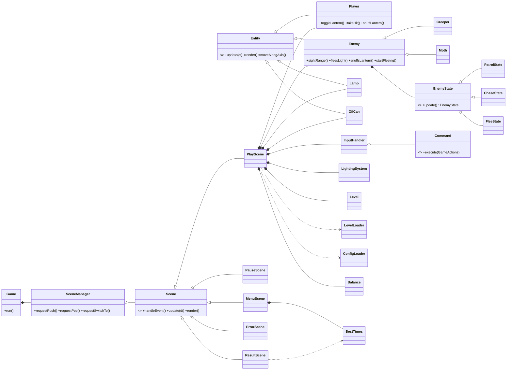
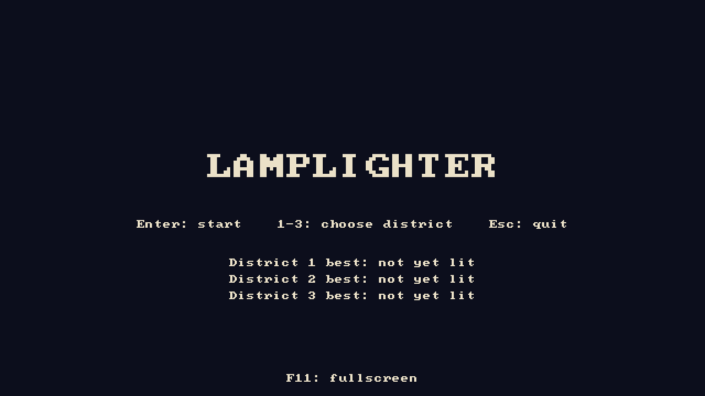
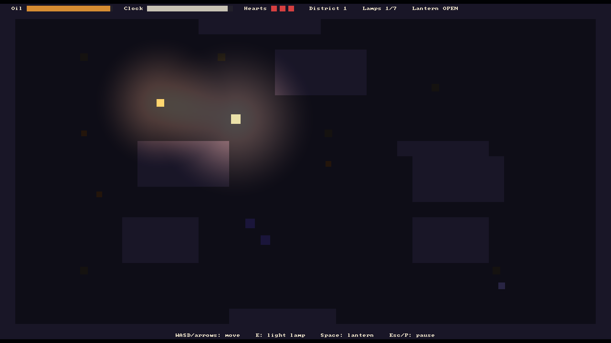
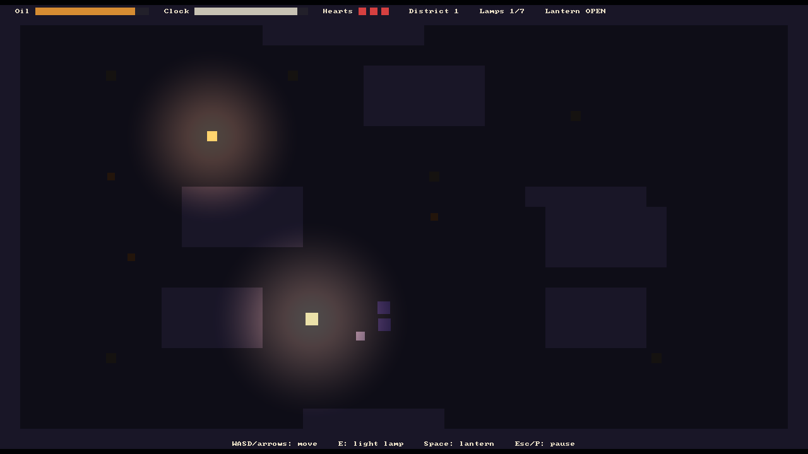
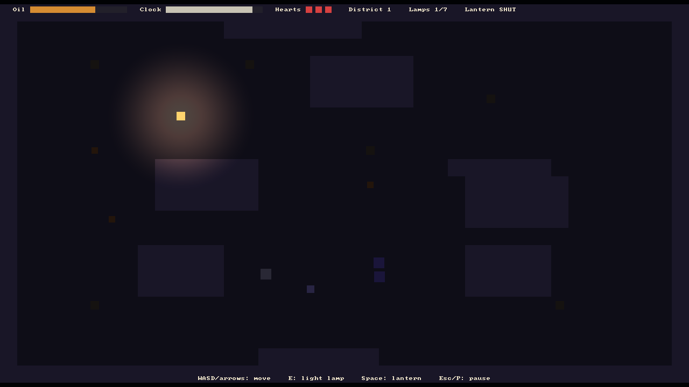
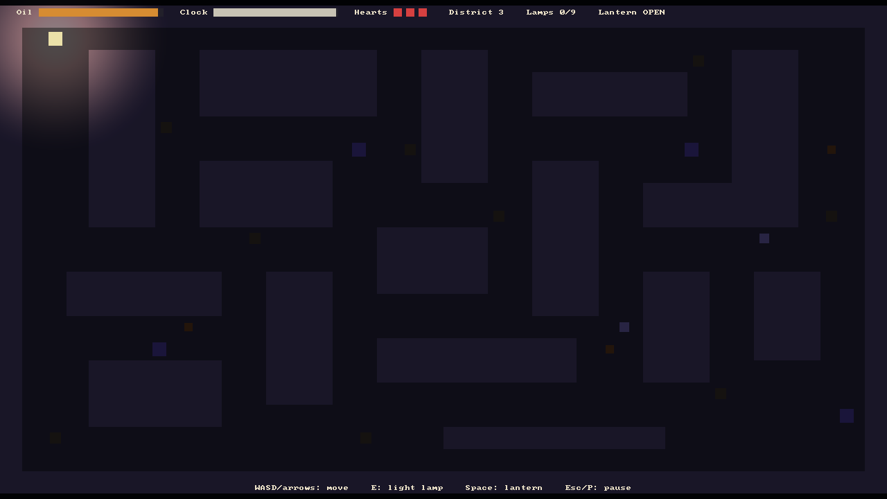
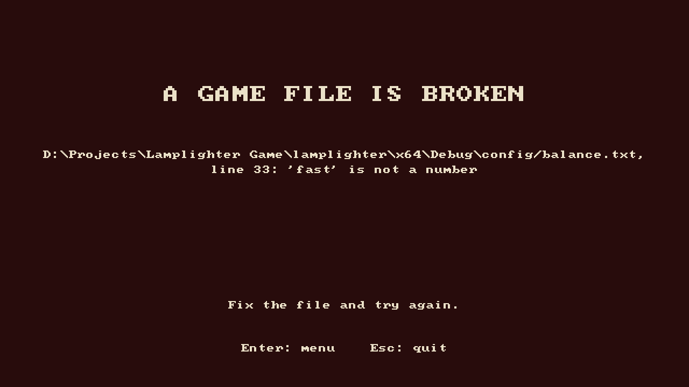
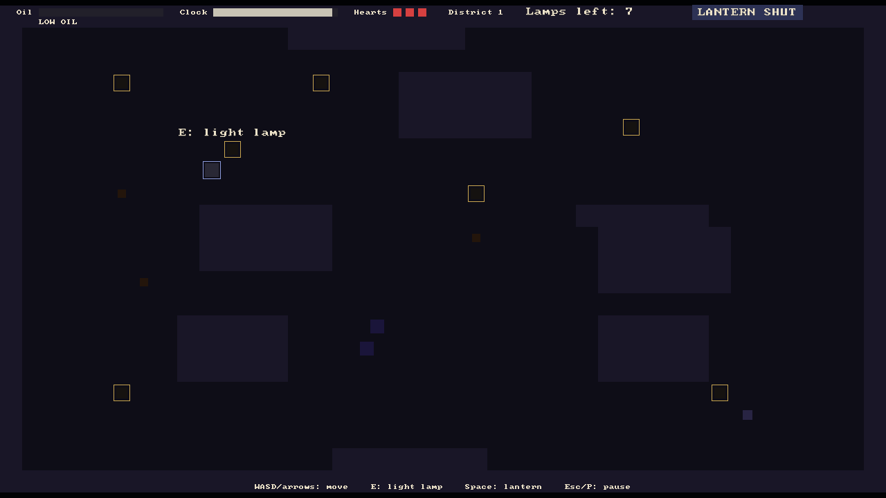

# Lamplighter

A top-down 2D stealth-puzzle game in C++ and SDL3, made for COMP3016 Immersive Game Technologies (Coursework 1).
Relight every street lamp in the district before the candle-clock burns out, while the shadows hunt anything the light does not touch.

## Video

YouTube (unlisted, 1080p, max 10 minutes): **[You add the link]**

## How to run

**From the submission zip:** unzip it and double-click `Lamplighter.exe`. These must stay in the same folder as the exe: `SDL3.dll`, `SDL3_image.dll`, and the `assets`, `config` and `levels` folders.

**From source:** open `Lamplighter.sln` in Visual Studio 2022, choose **x64** and **Debug** or **Release**, and press **F5**. SDL3 and SDL3_image are already in `external/`, so nothing else needs installing. A post-build step copies the DLLs and data folders next to the exe.

| Key | Action |
| --- | --- |
| WASD or arrow keys | Move (8 directions) |
| E | Light the nearest lamp |
| Space | Open or shut the lantern |
| Esc or P | Pause |
| Enter / 1-3 | Start district 1 / start that district (menu) |
| N, R, Enter | Next district, retry, menu (result screen) |
| F11 | Fullscreen |

Balance values, such as enemy speed, oil and clock length, are in `config/balance.txt` and can be changed without recompiling. Best times are saved to `best_times.txt` next to the exe.

## Proposal and deviations

The Week 2 proposal: [docs/proposal/PROPOSAL.md](docs/proposal/PROPOSAL.md) (submitted as [PDF](docs/proposal/Lamplighter_CW1_Proposal.pdf)).

| Change from the proposal | Why |
| --- | --- |
| No sound (irrKlang not added) | **[You check the reason]** Cut to finish the core game, districts and playtesting in time. |
| Coloured shapes instead of sprites and animation | **[You check the reason]** Time, and SDL3_image approval was still pending. The renderer draws every entity in its own `render()`, so sprites can replace the shapes without changing the gameplay code. |
| SDL3's built-in debug font instead of my own bitmap-font class | Part of SDL3, so no extra library; it was enough for the HUD and menus. |
| No scrolling camera | Every district is 40 x 22 tiles, which fits the 1280 x 720 screen. |
| Enemy routes are not loaded from files | Creepers patrol back and forth from where the level file places them. Levels and balance values are still loaded from text files. |
| Event Queue and Object Pool patterns not used | The game has at most 6 enemies and no particles, so direct calls were simpler and pooling had nothing to gain. |
| One playtest round instead of two | **[You write the reason and the date]** |
| Added: a shut lantern also hides the player from Creepers (they notice it from 3 tiles instead of 7) | It makes the lantern dilemma a real choice: open keeps Creepers away but is seen from far off. |
| Added: a Moth snuffs the lantern and spills oil | The proposal said a Moth "seeks an open lantern" but not what happens when it arrives. |

## Gameplay description

You are Emberfall's last lamplighter. Each district starts dark, with unlit street lamps, a few oil cans, Creepers and Moths.

- **Goal:** light every lamp (E) before the candle-clock runs out (150 seconds, raised from 120 after playtesting).
- **Lantern:** open, it lights the way and Creepers run from it, but it burns oil, its light shrinks as the oil drains, and Moths are drawn to it. Shut, it saves oil and hides you, but you are in the dark.
- **Oil:** refill by standing in a lit lamp's light or picking up an oil can.
- **Creepers** patrol, chase you through the dark and flee from light. One touching you in the dark costs a heart.
- **Moths** fly at an open lantern from 9 tiles away. One reaching you puts the lantern out and spills oil.
- **Lose:** all 3 hearts gone, or the clock runs out. **Win:** every lamp lit. The fastest win in each district is saved.

There are three districts, each with more lamps and enemies than the last (7, 8 and 9 lamps; 3, 4 and 6 enemies).

## Dependencies

- **SDL3 3.4.18:** window, renderer, input, timing and the debug-font text.
- **SDL3_image 3.4.8:** linked and loaded at start-up for sprites, but not yet used, because approval was pending.

Both are committed in `external/` with their headers, libs and DLLs, so the project builds on a clean lab PC.

## Use of AI and AI Development Log

**[You check this summary]** I used Claude Opus 5.5 in VS Code (Claude Code) as a coding assistant and Claude on claude.ai for planning. Every use is in [docs/AI_LOG.md](docs/AI_LOG.md) with my prompt, what it produced, how it was checked and which commits it wrote. I typed the `Level`, `LevelLoader` and `ConfigLoader` code myself from step-by-step explanations, and designed the District 1 map (the building positions were suggested by Claude). Most of the remaining code was written by Claude to my plans and choices; I reviewed it and ran every build.

## Game programming patterns

From Nystrom (2014) *Game Programming Patterns*.

| Pattern | Where | Why |
| --- | --- | --- |
| **Game Loop** | `Game::run` | A fixed 60 Hz update with an accumulator, so the game runs at the same speed on any PC. Catch-up is capped at 0.25 s after a stall. |
| **Update Method** | `Entity::update`, `Scene::update` | Every entity and scene updates itself once per fixed step. |
| **State** (scenes) | `SceneManager`, `Scene` | Menu, Play, Pause, Result and Error are states on a stack. Pause sits on top of a frozen Play. Changes are requested and applied after the scene's code finishes, so a scene is never destroyed while it is running. |
| **State** (enemy AI) | `EnemyState`: `PatrolState`, `ChaseState`, `FleeState` | Each state's `update` returns the next state, and `Enemy` swaps it in afterwards. |
| **Command** | `Command`, `InputHandler`, `GameActions` | E and Space are bound to command objects, so keys can be rebound without changing gameplay code. |

Also used: **RAII** wrappers (`std::unique_ptr` with SDL deleters in `SdlHandles.h`, and `SdlContext` for `SDL_Init`/`SDL_Quit`), so every SDL object is freed even when an exception is thrown.

## Game mechanics and how they are coded

- **Movement and collision:** `Player::update` reads `InputHandler::movementDirection` and scales diagonals by 1/sqrt(2). `Entity::moveAlongAxis` moves along X and Y separately and pushes the entity out of any wall tile, so it slides along walls. Enemies use the same function.
- **Lantern and oil:** `Player::update` drains oil while the lantern is open, and `Player::lightRadius` shrinks the light from 5.5 to 2 tiles as the oil drains.
- **Lighting:** `LightingSystem` draws each light as a soft glow into a 1280 x 720 light map with additive blending, then multiplies it over the scene. Unlit areas keep a dim "moonlight".
- **Lamps:** `PlayScene::lightNearbyLamp` lights the closest unlit lamp within 1.5 tiles. `litLampCovering` decides whether a point is inside a lit lamp's light, which is used for safety, refilling oil and scaring Creepers.
- **Enemy senses:** `PlayScene::sensesFor` fills an `EnemySenses` struct (player position, sight range, whether the enemy is in light), so enemies never need to know about lamps or the player class.
- **Creeper:** patrols until the player is in sight, chases, and flees from light. A hit counts only in darkness.
- **Moth:** `fleesLight()` is false and `snuffsLantern()` is true, so the same states make it chase an open lantern. `Player::snuffLantern` shuts the lantern and spills oil, and `Enemy::startFleeing` sends the Moth away.
- **Hearts, clock, win and lose:** `Player::takeHit` costs a heart, then gives 1.5 s of safety. `PlayScene::update` counts down the clock and switches to `ResultScene` on a win or a loss.
- **Changes from playtest 1:** `PlayScene::drawHud` shows a coloured LANTERN OPEN or SHUT badge, a larger "Lamps left" count and a flashing LOW OIL warning below a quarter of a tank. `PlayScene::render` draws over the lighting a ring round each unlit lamp, an "E: light lamp" prompt over the lamp `lampInReach` finds, and an outline round the player while the lantern is shut. The clock went from 120 to 150 s and a tank of oil from 45 to 55 s in `config/balance.txt` (Issues #1 to #3).
- **Data-driven design:** `LevelLoader` reads districts from text files (one character per tile). `ConfigLoader` reads `name = value` balance settings over the defaults in `Balance`. `BestTimes` saves and loads the fastest wins.

## UML design diagram

The proposal's UML sketch is in [docs/proposal/img/uml-sketch.svg](docs/proposal/img/uml-sketch.svg). This diagram shows the classes as built.

## Sample screens

Shapes are placeholders for sprites (see the deviations table).

| | |
| --- | --- |
|  |  |
| **Menu:** district select and best times | **District 1:** a lamp lit (top left) and the open lantern |
|  |  |
| **Lantern dilemma:** the Creepers (purple) stay at the edge of the light, but a Moth (pale) flies straight in | **A moment later:** the Moth has snuffed the lantern (SHUT, oil down 20%) and flutters off, and the Creepers can now close in |
|  |  |
| **District 3:** 9 lamps, 4 Creepers, 2 Moths | **Error screen:** a broken `balance.txt` is reported with its line instead of crashing |

**After playtest 1:** the changes made for Issues #1 and #2. Unlit lamps have gold rings, an "E: light lamp" prompt shows over the lamp in reach, "Lamps left" is larger, the lantern state is a coloured badge, the player is outlined while the lantern is shut, and LOW OIL flashes. This shot used a test config with a 6-second tank, so the oil is empty.

## Exception handling and test cases

**How errors are handled:**
- **Level and config files:** `LevelLoader` and `ConfigLoader` throw `LevelLoadError` or `ConfigLoadError` with the file name and, where it helps, the line. `PlayScene::start` catches them and opens `ErrorScene`, which shows the message. The player can go back to the menu instead of the game crashing.
- **Unknown level characters** are logged and treated as floor. Unsafe config values, such as a zero clock, which would divide by zero, are rejected.
- **The best-times save file** is player data, so a missing or damaged file is logged and skipped, never fatal. A failed save is also only logged.
- **SDL start-up failures** (window or renderer) throw `std::runtime_error`. `main` catches it and shows a message box, because there is no renderer to draw an error screen with.
- **Every SDL call that can fail** is checked through `checkSdl`.

**Test cases.** All of these were run. The "By" column says who ran each test; Claude's were run through small test programs or by driving the game.

| # | Input | Expected | Result | By |
| --- | --- | --- | --- | --- |
| 1 | No `district1.txt` | Error naming the missing file, no crash | Pass | Claude, 22 Oct |
| 2 | Empty level file | "Level file is empty" | Pass | Claude, 5 Nov |
| 3 | A row 4 tiles wide in a 5-wide map | Error names line 3 and both widths | Pass | Claude, 5 Nov |
| 4 | 2 x 2 map | "must be between 3x3 and 200x200" | Pass | Claude, 5 Nov |
| 5 | No `P`, or two `P` | "needs exactly one player start" | Pass | Claude, 5 Nov |
| 6 | No `L` | "needs at least one lamp" | Pass | Claude, 5 Nov |
| 7 | Unknown character `x`, Windows line endings, blank last line | Map loads; `x` is floor | Pass | Claude, 5 Nov |
| 8 | `clockSeconds = 20` | Run ends after 20 s | Pass | Me, 2 Nov |
| 9 | `clockSeconds = fast` | Error names the line (27 on 2 Nov; 33 after the Moth settings were added) | Pass | Me, 2 Nov (message box); Claude, 5 Nov (error screen) |
| 10 | `clockSecond = 120` (misspelt) | "unknown setting 'clockSecond'" | Pass | Me, 2 Nov |
| 11 | Config values `12abc`, empty, `1e999`, `nan`, `inf` | "is not a number" | Pass | Claude, 2 Nov |
| 12 | Config values `0`, `-5`, `moonlight = 300`, `startingHearts = 0` | "is not allowed for ..." | Pass | Claude, 2 Nov |
| 13 | No config file | "Cannot open config file" | Pass | Claude, 2 Nov |
| 14 | No `best_times.txt` | No best times shown, no crash | Pass | Claude, 5 Nov |
| 15 | Damaged `best_times.txt` (text, negative time, unknown district, extra words) | Bad lines skipped and logged, good lines kept | Pass | Claude, 5 Nov |
| 16 | Win, then win slower, then faster | Only the faster win replaces the best; it survives a restart | Pass | Claude, 5 Nov |
| 17 | Moth with lantern open, with lantern shut, after snuffing | Comes closer / does not come closer / flies away | Pass | Claude, 5 Nov |

## Playtesting evidence and reflection

Evidence is in [docs/playtesting](docs/playtesting).

**Who and how.** One round of playtesting was conducted online on 5 November 2026 with three testers: one who plays games daily, one weekly, and one sometimes. Each played District 1 three times. I gave them only the goal and controls, observed their first run without helping, and then asked them to complete a questionnaire with seven 1–5 ratings and four open questions. The full results are in [round-1/notes.md](docs/playtesting/round-1/notes.md).

**What they said.** The core idea came across clearly: understanding the goal averaged 4.7, tension 4.7, and wanting to play again 4.7. This supports the proposal's aim of creating a tense and replayable game. However, resource and enemy balancing were weaker areas. Oil fairness averaged 3.0, clock fairness 3.0, and Creeper fairness 3.0. The tester who plays games least frequently gave lower ratings, particularly for oil and enemy difficulty. Four of the nine runs were lost: two to Creepers and two when the clock ran out. All three testers won by their third run, suggesting that the game became easier to understand with practice. In the open answers, T3 struggled to identify whether the lantern was open or shut, T1 wanted clearer feedback when close enough to light a lamp, and T2 wanted to see how many lamps remained.

**What changed.** The findings were converted into GitHub Issues, and each was closed by the commit that fixed it:

- [#1](https://github.com/riyasah0963/lamplighter/issues/1), lantern state and low oil hard to see: added a coloured OPEN/SHUT badge, an outline around the player when the lantern is shut, and a flashing LOW OIL warning.
- [#2](https://github.com/riyasah0963/lamplighter/issues/2), unclear lamp interactions: added gold rings around unlit lamps, an "E: light lamp" prompt, and a larger "Lamps left" count.
- [#3](https://github.com/riyasah0963/lamplighter/issues/3), difficulty balancing: the tested build used a 120-second clock and 45 seconds of oil; these were increased to 150 seconds and 55 seconds respectively. Since the balance values load from `config/balance.txt`, this was changed without modifying the game code.

**Limitations.** This was a single round involving only three testers and was conducted later than planned. Individual run times were not recorded, so the results document uses "not recorded" rather than estimated times. The changes have not yet been tested with new players, meaning their effectiveness cannot be confirmed. A second round should focus on whether the revised time and oil balance feels fair, whether the lantern indicators improve understanding, and whether players understand why Moths follow an open lantern.

## Further details

- Each district is a 40 x 22 text file in `levels/` (`#` wall, `.` floor, `P` player, `L` lamp, `O` oil can, `C` Creeper, `M` Moth), so new districts need no code.
- All balance values are in `config/balance.txt`, and values left out keep their defaults from `Balance.h`.
- The commit history and week tags (`week-4`, `week-5`) show the development order. The AI log links each AI-assisted commit.

## Evaluation

**What went well.** The core gameplay loop works as intended and matches the proposal: players light street lamps against the clock, manage their oil, and choose between an open lantern that scares Creepers but attracts Moths and a shut lantern that saves oil but leaves them vulnerable in the dark. The lighting system created the atmosphere that testers enjoyed most. The game is data-driven, with districts and balance values loaded from text files, allowing gameplay adjustments through configuration rather than recompilation. Invalid level and configuration files display an error screen identifying the file and line instead of crashing, and these cases are covered by the test cases. The implementation also follows the design patterns outlined in the proposal, including Game Loop, Update Method, State for scenes and enemy AI, and Command for input handling.

**What did not go well.** I fell behind during weeks 5 and 6, which delayed the first playtest from the planned 29 October lab to 5 November. As a result, I could not conduct a second playtesting round to evaluate the effectiveness of the changes. To meet the deadline, I also reduced the scope by cutting sound, sprites, a custom bitmap font, the scrolling camera, and file-based enemy routes, as documented in the deviations table. The game therefore still uses coloured shapes, which limits its visual polish. Most of the code was generated by Claude based on my plans, so I needed additional time to read, understand, and test the implementation to ensure I could explain the design decisions and functionality.

**With more time.** I would add irrKlang sound effects for the lantern, lamps, and Creepers; replace the coloured shapes with sprites using SDL3_image; and conduct a second playtesting round to evaluate the changes. I would also implement file-based Creeper patrol routes and pursue the stretch goals from the proposal, including a fourth district and a simple level editor.

## Credits and references

- Nystrom, R. (2014) *Game Programming Patterns*. Available at: https://gameprogrammingpatterns.com/ (Game Loop, Update Method, State, Command).
- SDL3 and SDL3_image, zlib licence: https://www.libsdl.org/
- Claude Opus 5.5 (Anthropic), used as described in the AI log.

## Appendix: Generative AI declaration

**[You write this]** Use your own words to state:
- which AI tools you used and for what
- that every use is logged in `docs/AI_LOG.md`
- what you did yourself
