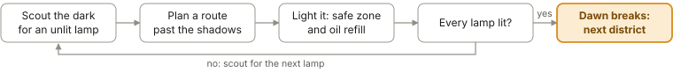
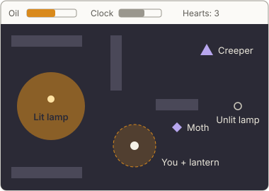
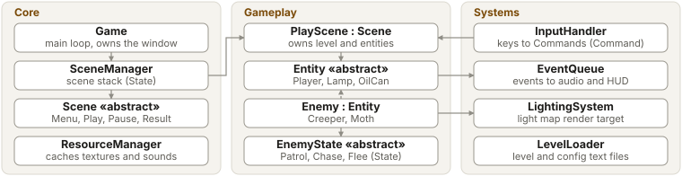

# Lamplighter: CW1 game proposal (MDA)

COMP3016 Immersive Game Technologies, Coursework 1. Submitted to the DLE on 23 October 2026 as [Lamplighter_CW1_Proposal.pdf](Lamplighter_CW1_Proposal.pdf).
This file is the same proposal in markdown so it can be linked from the final report.

**Genre:** top-down 2D stealth-puzzle · **Players:** 1 · **Built with:** modern C++, SDL3, irrKlang · **Target:** Windows, Visual Studio 2022

**Synopsis.** Every night, shadows creep out of the marsh around Emberfall and swallow anything the light does not touch. As the town's last lamplighter, with one lantern and never enough oil, you must relight every street lamp in the district before the candle-clock burns out.

## MDA framework

### Aesthetics: what the player feels

- **Challenge (primary):** the tension of a shrinking light and a ticking clock.
- **Fantasy:** the fragile keeper of light against the dark.
- **Discovery:** learning each district's routes and shadows.
- **Playtest target:** testers call it tense and replay to beat their time.

### Dynamics: what emerges in play

- **Light as territory:** each lit lamp is safe ground for good, so the map turns safe as the clock squeezes.
- **Risk or reward:** a dark shortcut, or a safe detour past lit lamps.
- **Oil economy:** the light shrinks as oil drains, so refills need planning.
- **Lantern dilemma:** open, it repels Creepers but draws Moths; shut, it hides you but blinds you.

### Mechanics: rules the code enforces

- 8-way movement, tile collision; **E** lights a lamp; **Space** opens or shuts the lantern.
- Oil drains while open; refill at lit lamps or oil cans.
- **Creeper** patrols, chases in darkness, flees light. **Moth** seeks an open lantern.
- 3 hearts; a hit in darkness costs one. Win: all lamps lit before the clock ends.
- 3 districts; best times saved to and loaded from a file.

## Core gameplay loop

Fail state: lose all hearts or let the clock run out, then retry the district.

## Gameplay sketch

## Architecture and UML sketch

Solid arrow: owns or uses. Dashed arrow: inherits.

**Patterns (Nystrom, *Game Programming Patterns*):** Game Loop and Update Method; State for scenes and enemy AI; Command for input, so keys can be rebound; Event Queue to decouple sound and HUD from gameplay; Object Pool for particles and enemies.

## Technical features

- **Data-driven:** levels, enemy routes and balance values load from text files, so playtest tuning needs no recompile.
- **Lighting:** a light-map render target with additive light sprites, multiplied over the scene.
- Fixed-timestep loop, scrolling camera, sprite animation, irrKlang sound.
- **Modern C++:** RAII wrappers for SDL resources, `std::unique_ptr`, `std::string`.
- **Robustness:** a bad level file shows an error screen, not a crash; documented test cases.

## Libraries and AI use

**Libraries:** SDL3, SDL3_image for PNG sprites (approval requested; BMP fallback), irrKlang. My own bitmap-font class, so no SDL3_ttf.

**AI use** (logged in [`docs/AI_LOG.md`](../AI_LOG.md) with prompts, review notes and linked commits):

- **Code:** Claude in VS Code for scaffolding, refactoring, debugging and tests; all reviewed and explainable.
- **Assets:** open-source Stable Diffusion sprite drafts, cleaned by hand; CC0 sounds, cited.
- **Docs:** README drafting; balance ideas checked against playtests.

## Development roadmap

| Week | Dates | Milestone |
| --- | --- | --- |
| 4 | 19–25 Oct | Repo, SDL3 project, game loop, scene states, level loader, movement and collision. Proposal submitted 23 Oct. |
| 5 | 26 Oct–1 Nov | Lantern, oil, lighting, lamps, Creeper AI, HUD. First playable build; playtest 1 in the 29 Oct lab. |
| 6 | 2–6 Nov | Moth, audio, 3 districts, menus, saves. Playtest 2, balancing, fixes, report and video. Submit 6 Nov. |

**Playtesting:** questionnaire and observation notes each round; findings filed as GitHub Issues and closed by commits.

**Stretch goals:** a fourth district, a third enemy type, a simple level editor.
